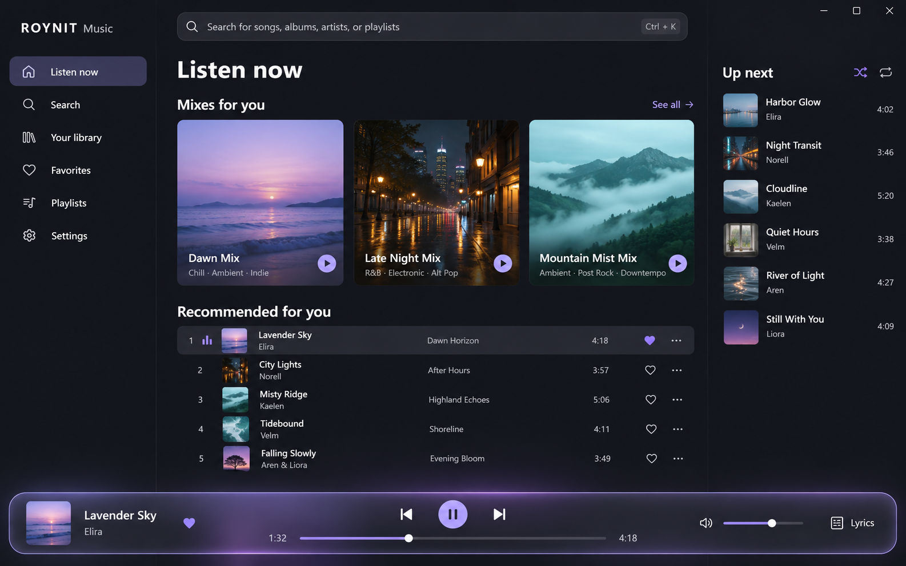

# Prompt cho Claude · Hoàn thiện giao diện Roynit Music

Hãy chỉnh giao diện Roynit Music trong repo Rust đang mở cho đủ chỉn chu để dùng nghe nhạc mỗi ngày trên Windows. Đọc `CLAUDE.md`, `tiendo.md` và `docs/UI-HANDOFF.md`, kiểm tra `git status --short`, rồi chạy bản hiện tại để xem bố cục thực tế. Giữ các thay đổi local, đặc biệt bản sửa “Nothing loaded”. Làm giao diện và chuyển động trên egui hiện tại.

## Ảnh minh họa

Dùng ảnh để lấy tỷ lệ ba cột, mật độ danh sách, thứ bậc chữ và điểm nhấn ở thanh phát. Tên bài, thể loại và ảnh bìa trong hình là minh họa. Bản chạy dùng metadata và bìa thật. Nếu Claude không tự đọc ảnh nhúng, mở trực tiếp `docs/design/roynit-music-reference.png` trước khi sửa.

## Chất Roynit

- **Graphite + Iris.** Nền graphite `#14151D`, mặt nổi `#1E202B`, chữ chính `#F2F1F7`, chữ phụ `#AAAEBE`, nút chính Iris `#AA98FF`. Dùng một bộ icon cùng nét và font đọc tốt tiếng Việt. Giữ độ tương phản rõ ở chế độ sáng lẫn tối.
- **Một điểm nhận diện.** Thanh phát nổi ở đáy có viền kính mỏng và quầng sáng nhẹ lấy màu từ bìa bài. Tập trung ánh sáng gần artwork. Lúc chưa phát chỉ dùng nền và viền nhẹ. Để phần thư viện và danh sách dùng bề mặt phẳng.
- **Nhạc đứng trước giao diện.** Cho bìa album, tên bài và nghệ sĩ tạo điểm nhìn. Tránh thẻ to giống nhau, khoảng trống không có tác dụng, gradient phủ rộng, nhãn “Rust preview” và các câu quảng cáo thừa trong màn nghe nhạc.

## Những chỗ cần sửa trước

1. **Listen now.** Thu thẻ Mix để thấy trọn ba thẻ ở cửa sổ desktop thông thường ngay cả khi Up next mở, và thấy vài dòng gợi ý mà chưa cần cuộn. Điều chỉnh kích thước theo phần nội dung còn lại. Ở cửa sổ hẹp, dùng hàng cuộn có dấu hiệu rõ hoặc giảm số cột. Bấm bìa hoặc tên để mở Mix, một nút Play trên ảnh, các thao tác phụ như lưu cho vào `…`. Bỏ “0 tracks” trên Home khi đã có Mix. Chỉ hiển thị thể loại nếu có dữ liệu thật.
2. **Điều hướng và Up next.** Sidebar thấp hơn để Downloads và Settings dễ với tới. Dùng ranh giới nhẹ giữa các vùng thay vì bọc mỗi mục vào một thẻ. Up next và Lyrics dùng chung bảng phải, đóng được, tự trở thành ngăn mở từ player khi thiếu chiều ngang. Giữ tên bài dài trên một dòng rút gọn và có cách xem tên đầy đủ. Làm rõ bài đang phát và bài kế tiếp.
3. **Thanh phát.** Bìa và tên bài bên trái. Previous, Play/Pause, Next và timeline có vị trí cố định. Âm lượng, Up next, Lyrics và More ở nhóm phải. Giữ nút dễ bấm, có nhãn truy cập và focus bàn phím. Cho thấy bài đang phát khác với bài đang chuẩn bị. Khi chưa có audio, thanh tua vẫn khóa.
4. **Search và Library.** Dùng cùng hàng bài hát và cách nhóm thao tác với Home. Giữ tìm kiếm hiện kết quả khi gõ, chip nguồn và bộ lọc có nhãn rõ. Ưu tiên tên bài, nghệ sĩ và thời lượng. Dùng trạng thái riêng cho đang tìm, không có kết quả và lỗi kết nối. Giữ hành vi chọn nhiều, lọc, xếp lại và tải offline.

## Chuyển động và kiểm tra

Phản hồi Play ngay khi bấm. Chuyển bìa và màu khoảng 180 ms, bảng phụ khoảng 160–220 ms. Dùng chuyển động để giải thích thứ gì vừa mở, đổi hoặc được thêm vào. Giảm chuyển động thì cập nhật trực tiếp. Tránh animation lặp ở mọi thẻ và tránh hiệu ứng nặng khi cuộn hoặc phát nhạc.

Giữ bộ phát FFmpeg + rodio, thư viện hiện tại, Discover/Mix, nguồn Spotify/YouTube Music, kiểm đúng bản thu Spotify, Autoplay, Smart Shuffle, Windows SMTC và cơ chế cập nhật. Audio Studio nằm ngoài phạm vi. Ảnh này là tài liệu thiết kế, không dùng làm nền hoặc làm ảnh thay cho các thành phần tương tác.

Làm xong **Listen now và player** trước, mở bản native để kiểm bằng dữ liệu thật rồi áp các thành phần chung cho màn còn lại. Kiểm ở cửa sổ 1120×700 và ít nhất một cửa sổ rộng hơn, với Up next bật và tắt. Chụp ảnh màn mặc định, màn đang phát, và một màn tìm kiếm. Thử bàn phím, scaling Windows, giảm chuyển động, bản ghi thiếu artwork, chuyển bài, tua và Play khi chưa có audio. Báo lại những file đã sửa và kết quả kiểm. Chưa phát hành khi chưa có yêu cầu.
